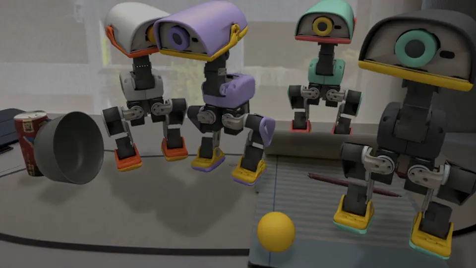

# Microduck in my home, with RoboSimStudio

I took one phone photo of my desk. Codex turned it into a physics twin on
[RoboSimStudio](https://github.com/KeplerC/robosimstudio)'s live page, and
Pollen Robotics' [Microduck](https://github.com/pollen-robotics/microduck)
now lives in it. I pick the duck up with the mouse, walk it around with the
keyboard, and it kicks a ball into my bowl and picks up my sock.



The [video](media/microduck_home.mp4) is RoboSimStudio's World model view all the way through. It opens on the
render alone: a flock of four (`--ducks=4`), the lavender one forward-rolling into the white one and both going off
the table with my coffee can. Then the photo the desk was rebuilt from comes alive as the page, and the rest is one
take with nothing reset: the duck picked up by its head and carried in with the gizmo, **D** to turn it to the
ball, the physics under the World model view, **Space** for a kick into the bowl, and **A** to turn it back to me.

What it shows, in RoboSimStudio:

1. **Real to sim from one photo.** Codex rebuilt the desk on the live page
   in 29 minutes. It solved the phone's camera, put everything on the desk at
   its real size as a collider, made the bowl hollow, and measured that
   nothing creeps. Seen through that camera, the twin is drawn over the
   photo's own pixels, so it looks like the photo until something moves.
2. **A real robot policy in it.** The Microduck stands on its own walking
   policy, the one the real robot runs, with nothing holding it up but its
   feet.
3. **Play, in the page's World model view.** The view is RoboSimStudio's path
   tracer drawing through the photo's camera. You drag things with the mouse,
   and **W A S D**, **Space**, **E** and **Q** drive the duck.

## Play on my desk

You need Linux, an NVIDIA GPU with RT cores for the path-traced view, and
[uv](https://docs.astral.sh/uv/).

```bash
git clone https://github.com/KeplerC/microduck-with-rss.git
cd microduck-with-rss
uv run home.py
```

Open the address it prints. The first run installs RoboSimStudio, and
downloads the robot and its policies (see [The robot's files](#the-robots-files)).
The path-traced view takes about a minute to draw its first frame.

| | |
|---|---|
| **Drag** the duck | Click it, then drag the handle to pick it up and put it down anywhere. It squawks while its feet are off the desk. |
| **W / S** | Walk forward / back. |
| **A / D** | Turn left / right. |
| **Space** | Walk up to the ball and kick it where the duck is facing, or into the bowl if the bowl is roughly that way. |
| **E** | Walk up to the sock and pick it up in the beak. Press again to put it down. |
| **Q** | Quack. |

While it stands, the duck watches the ball. When the ball lands in the bowl
it wiggles its head and claps its beak; when a kick stops short, it hangs its
head. The ball, the bowl, the can and the pen are real bodies too, and the
sock is a soft one: drag them around. **Reset** puts everything back.

### A flock

```bash
uv run home.py --ducks=4
```

Four ducks in four colours, each with its own way of passing the time: the
white one strolls about (the keys steer it), the charcoal one sits down on
the notepad and gets up again, the mint one pecks at the desk, and the
lavender one does forward rolls towards the camera and walks back. **Q** is a
chorus. A forward roll is Pollen's own trick policy and goes a different way
almost every time, so now and then the roller lands on its back; **Reset**
stands it up. There is no sock in the flock: it is most of the step's cost.

## Make a twin of your own room

A twin is a folder: a `scene.py`, its assets, the photo and a `REPORT.md`.
`home_desk/` here is mine. To make your own, take a photo and have a coding
agent build it on RoboSimStudio's live page:

```bash
git clone https://github.com/KeplerC/robosimstudio.git
cd robosimstudio/examples/live
./ctl new my_room --ref ~/Pictures/my_room.jpg   # makes twins/my_room/ and copies the photo into its ref/
cd twins/my_room
./ctl up                                         # starts the live page; open the address it prints
codex                                            # in this folder, with a prompt like the one below
```

This is the prompt `home_desk/` was built with, generalised:

```
Create a simulation environment based on the photo at ref/my_room.jpg: <what it is, and the camera, e.g. an
iPhone's main camera, 24 mm equivalent>.

This twin is the set for a showcase, and it has no robot arm. Later a Microduck (a 25 cm walking biped) will be put
down with the mouse, walk about, and kick a ball about 45 mm across into <the bowl>. So:

- Leave any robot out of scene.py, and no routine is needed.
- Everything it walks on or can touch is at its true size and is a collider; <the bowl> is hollow, with a real cavity
  a ball can roll into.
- What a ball or the duck may knock over is a rigid body with its real mass, drawn by the render, not left in a plate.
- The table it stands on must be at least the area the photo shows.
```

The live page rebuilds `scene.py` every time the agent saves it, so you can
watch the twin come together and drag things on it as it does. Codex reads
the method by itself (`examples/live/AGENTS.md`). When it is done, put the
duck in:

```bash
uv run home.py ~/robosimstudio/examples/live/twins/my_room
```

`home.py` loads the twin's own `scene.py`, puts the duck and a ball on its
desk, and opens the page through the twin's `phone` camera. A twin of your
own will name things its own way, so set `DUCK_AT`, `BALL_AT` and the bowl's
name in `home.py` to match.

## How it works

- **`duck.py`** is the Microduck as a kind of thing in RoboSimStudio. Pollen's
  MJCF (`robot_groundcontact.xml` from
  [`microduck_rl`](https://github.com/pollen-robotics/microduck_rl)) goes on a
  free joint. Once per control step the entity's `before` hook runs the
  official ONNX policies
  ([`pollen-robotics/microduck-policies`](https://huggingface.co/pollen-robotics/microduck-policies),
  tag `v8`) from the 61-float observation they share: `velstand` walks and
  stands, and `ball_kick_left/right` kick. The physics is MuJoCo at a 5 ms
  step with 50 Hz control, the rates the policies were trained at. Its moods
  are short head-and-beak keyframes played over the gait, which keeps its
  balance around them. A bite is Pollen's ground-pick policy with its body
  command crouched 40 mm, which takes the beak down until the bill touches the
  desk, the head tipped 20 degrees forward on its own servo, and the beak
  opened on the way down and shut at the bottom.
- **`assets.py`** downloads the robot and its policies, and adds the beak. The
  official model has no mouth joint, so the lower beak gets a hinge on the
  mouth servo's axis.
- **`keys.py`** brings the keyboard into the page. viser has no keyboard
  events, and its own camera flies on W A S D. So a few lines of JavaScript,
  carried in an HTML element on the panel, catch the keys before viser does.
  They write the held keys into a hidden text field, which viser sends to
  Python like any edit.
- **`sock.py`** is the sock: a wool sock folded in half, 95 x 30 x 25 mm
  and 25 g, as a soft body of 2850 tetrahedra. It runs on Newton's VBD beside
  the duck's MuJoCo, coupled one way: the beak, the feet and the desk push it,
  and nothing pins it to the beak. The beak holds it by squeezing and
  friction alone.
- **`play.py`** is the duck at play: the keys, the kick, the fetch, and its moods. The
  kick is Pollen's own one-shot policy, and it cannot see the ball: it swings
  through one spot. So **Space** first lines the duck up. It walks in along
  the aim line until the ball sits 60 mm ahead of it and 30 mm out to one
  foot, then kicks with that foot. The bite cannot see the sock either, so
  **E** walks in square to the sock's long side, steps back or in until the
  sock's middle lies 50 to 85 mm ahead and within 30 mm of its own, bites,
  and bites again when the sock did not come up.
- **`home.py`** is the page. It loads the twin, adds the duck, the ball and
  the sock, gives the ball the rolling resistance of a desk mat, and opens the
  World model view locked to the photo's camera.

How often a kick scores, measured headless on this desk: from 13 to 19 cm
behind the ball, facing the bowl give or take 8 degrees, 5 of 12 kicks ended
in the bowl. The rest stopped on the desk near it, ready for another try,
and once the duck tripped over the ball. The gait's steps are coarse (about
30 mm), and it can end a walk up to 14 degrees off the heading it was given,
which is most of the miss.

How often **E** brings the sock up, measured headless on this desk: from 8
spots 13 to 16 cm from the sock, facing it give or take 15 degrees, 7 times
the duck lifted the whole sock off the desk and kept it while it stood 3 s and
then walked 3 s; from 8 spots on the notepad 19 to 27 cm away, facing anywhere,
7 times again. A walk-up and bite takes 5 to 10 s.
The two misses: the sock slipped out of the beak once it was up, and once the
duck stepped onto the sock and gave up after 30 s. The desk steps 54 times a
second with the sock on it, against 220 without, so the page runs at about real
time.

Two things in `home_desk/` differ from what Codex delivered, both for the
duck, and its `REPORT.md` says why: the mat collides as one flat piece, and
`scene.py` lets `home.py` build it.

## The robot's files

None of the robot's files are in this repository. On first run, `assets.py`
downloads the MJCF and its meshes from `pollen-robotics/microduck_rl` at a
pinned commit, and the policies from the Hugging Face Hub at tag `v8`. They
go into `~/.cache/robosimstudio/microduck/`, and `MICRODUCK_CACHE` moves that
folder.

## Licence

The code here is Apache-2.0 (`LICENSE`). Microduck's code and policies are
Apache-2.0; its meshes are
[CC BY-NC-SA 4.0](https://creativecommons.org/licenses/by-nc-sa/4.0/),
which is why they are downloaded on first run rather than shipped. Microduck
is by Pollen Robotics and Hugging Face.
